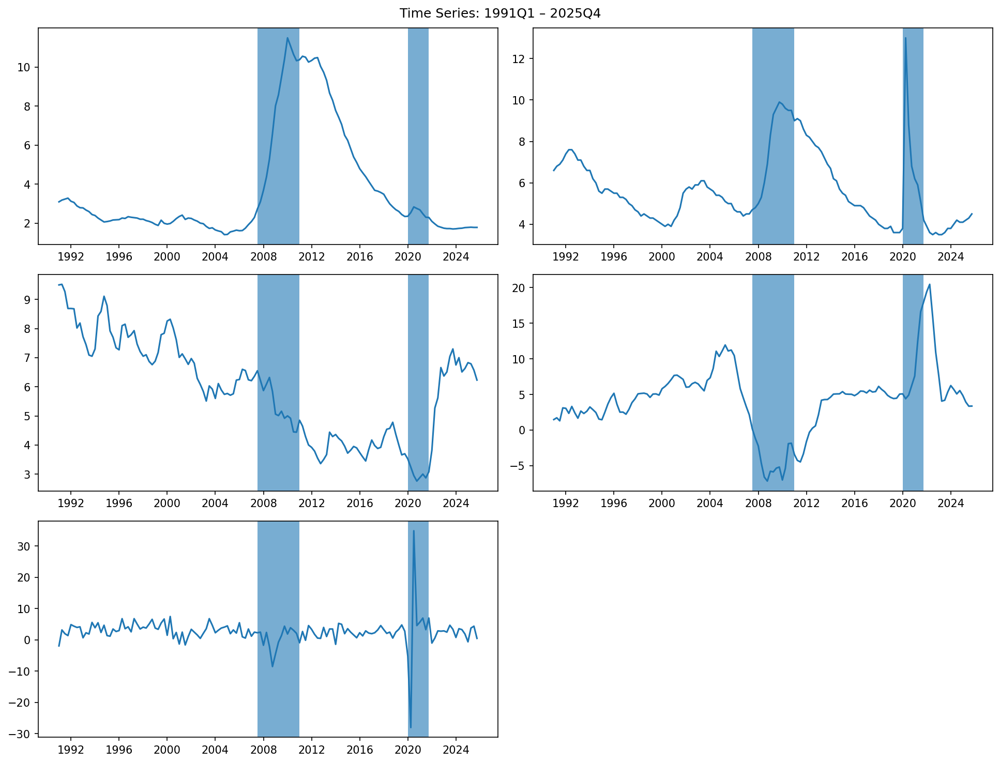
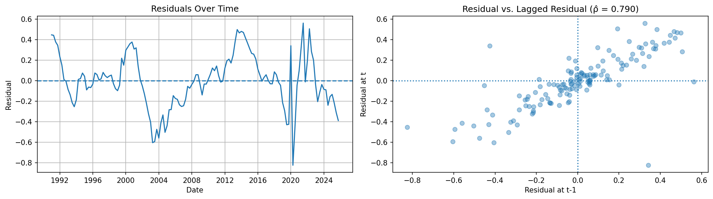

# What Drives U.S. Mortgage Delinquency?

An econometric study of quarterly single-family residential mortgage delinquency at U.S. commercial banks from **1991Q1–2025Q4**.

The project tests whether unemployment, mortgage rates, house-price growth, and real GDP growth help explain delinquency, while accounting for the 2008 financial crisis and the COVID-19 forbearance period. It includes a reproducible Python pipeline, regression diagnostics, robustness checks, publication-ready figures, and the accompanying research paper.



## Key findings

- **Unemployment is the strongest positive predictor.** In the final log-linear model, a one-percentage-point increase in unemployment is associated with approximately a **14.4% increase** in delinquency, using the exact semi-elasticity transformation and holding other included variables constant.
- **House-price growth is protective.** A one-percentage-point increase in year-over-year HPI growth is associated with approximately a **4.8% decrease** in delinquency.
- **COVID-era forbearance materially suppressed reported delinquency.** The estimated indicator effect is approximately **−54.3%**, conditional on the model covariates.
- **The mortgage-rate coefficient is negative**, contrary to the initial hypothesis. This should be read as a conditional association, not a causal effect: the series measures rates on newly originated loans rather than rates paid by the stock of delinquent borrowers.
- Residuals are both heteroskedastic and serially correlated, so the preferred specifications report **Newey–West HAC standard errors with four quarterly lags**.

These are macro-level associations. The design does not establish causality and does not include borrower-level credit, leverage, or loan-servicing characteristics.

## Final model

```text
ln(Delinquency) = 1.7734
                  + 0.1345 × UNRATE
                  − 0.1993 × MORTGAGE30US
                  − 0.0491 × HPI_Growth
                  − 0.7824 × D_Covid + ε
```

| Variable | Estimate | HAC SE | Interpretation |
|---|---:|---:|---|
| Unemployment rate | 0.1345 | 0.0326 | Positive association with delinquency |
| 30-year mortgage rate | −0.1993 | 0.0254 | Negative conditional association; not interpreted causally |
| HPI growth | −0.0491 | 0.0118 | Faster price growth is associated with lower delinquency |
| COVID forbearance period | −0.7824 | 0.1821 | Reported delinquency was substantially lower during the indicator period |

Adjusted R² = **0.8078**; n = **140** quarterly observations. Full estimates are in [`Output/final_results_table.txt`](Output/final_results_table.txt).

## Data and methods

All underlying series come from the Federal Reserve Bank of St. Louis FRED database. The checked-in workbook contains the analysis-ready quarterly sample.

| Field | Definition |
|---|---|
| `Delinquency` | Delinquency rate on single-family residential mortgages at commercial banks |
| `UNRATE` | Civilian unemployment rate |
| `MORTGAGE30US` | Average 30-year fixed mortgage rate |
| `HPI_Growth` | Year-over-year percent change in the All-Transactions House Price Index |
| `GDPGrowth` | Annualized real GDP growth |
| `D_Crisis` | 1 from 2007Q3–2010Q4, otherwise 0 |
| `D_Covid` | 1 from 2020Q1–2021Q3, otherwise 0 |

The pipeline compares level and log-linear OLS specifications; checks multicollinearity with VIFs; tests heteroskedasticity using Breusch–Pagan and White tests; tests serial correlation using Durbin–Watson and Breusch–Godfrey diagnostics; compares classical, HC3, HAC, and Cochrane–Orcutt approaches; and performs robust joint Wald tests to select the trimmed model.

## Reproduce the analysis

Python 3.12 is recommended.

```bash
git clone https://github.com/LenaWang1299/delinquency-rate-regression-.git
cd delinquency-rate-regression-
python -m venv .venv
source .venv/bin/activate
python -m pip install -r Requirements.txt
python main.py
```

The script can be launched from any working directory. It reads from `Data/` and regenerates all files in `Figures/` and `Output/`. A GitHub Actions workflow repeats the same analysis on every push and pull request.

## Repository structure

```text
.
├── Data/                 # Analysis-ready quarterly workbook
├── Figures/              # Generated exploratory and diagnostic figures
├── Output/               # Model summaries, tests, and results tables
├── .github/workflows/    # Reproducibility check
├── main.py               # End-to-end analysis pipeline
├── Requirements.txt      # Direct Python dependencies
├── Determinants of Single-Family Residential Mortgage Delinquency.md
└── README.md
```

## Selected diagnostics

| Diagnostic | Result | Response |
|---|---|---|
| Variance inflation factors | All below 5 | No severe multicollinearity detected |
| Breusch–Pagan | p < 0.001 | Reject homoskedasticity |
| White test | p < 0.001 | Reject homoskedasticity |
| Breusch–Godfrey (4 lags) | p < 0.001 | Reject no serial correlation |
| Cochrane–Orcutt | ρ̂ ≈ 0.994 | Treated as a robustness diagnostic, not the primary model |



## Limitations

- The delinquency series covers bank-held mortgages, not the entire U.S. mortgage market.
- Quarterly aggregation masks within-quarter shocks.
- COVID forbearance changed how financial distress appeared in reported delinquency.
- Strong persistence remains in the dependent variable. HAC standard errors improve inference but do not turn the static specification into a causal or fully dynamic model.
- Current mortgage rates are an imperfect proxy for the contract rates faced by existing borrowers.

## Authors

Joan Chong, Lena Wang, Mitchell Brink, and Adelaide Lin — USC ECON 318.

For full motivation, literature review, model interpretation, and references, see the [research paper](Determinants%20of%20Single-Family%20Residential%20Mortgage%20Delinquency.md).
